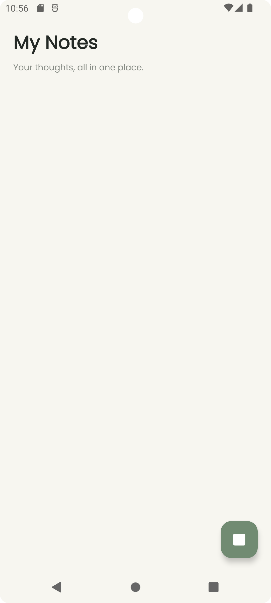
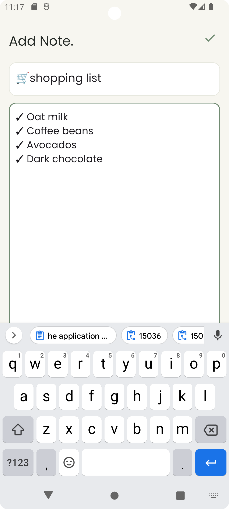
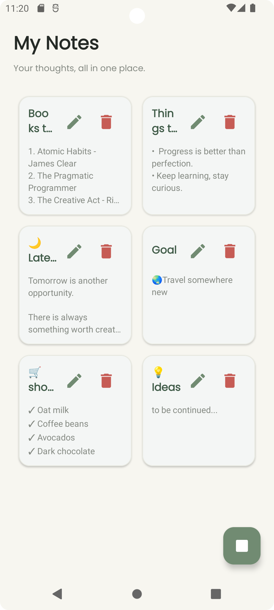

# 📝 Kotlin Notes App

A simple Android notes application built with **Kotlin** and **SQLite**. This application allows users to create, view, edit, and delete personal notes while storing data locally on their devices.

## ✨ Features

- Create new notes
- View all saved notes
- Edit existing notes
- Delete unwanted notes
- Store notes locally using SQLite


## 🛠️ Technologies

- **Language:** Kotlin
- **Platform:** Android
- **Database:** SQLite
- **IDE:** Android Studio / IntelliJ IDEA

## 📸 Screenshots

### 🏠 Home Screen


### Create Note


### My Notes 



### Prerequisites

Android Studio
JDK compatible with the project's Gradle configuration
Android emulator or physical Android device

### Installation

1. Clone this repository:

   ```bash
   git clone https://github.com/aigerimcode/Kotlin-Notes-App.git
   ```

2. Open the project in Android Studio.

3. Allow Gradle to sync and download the required dependencies.

4. Start an Android emulator or connect a physical Android device.

5. Click **Run** to build and launch the application.


---


